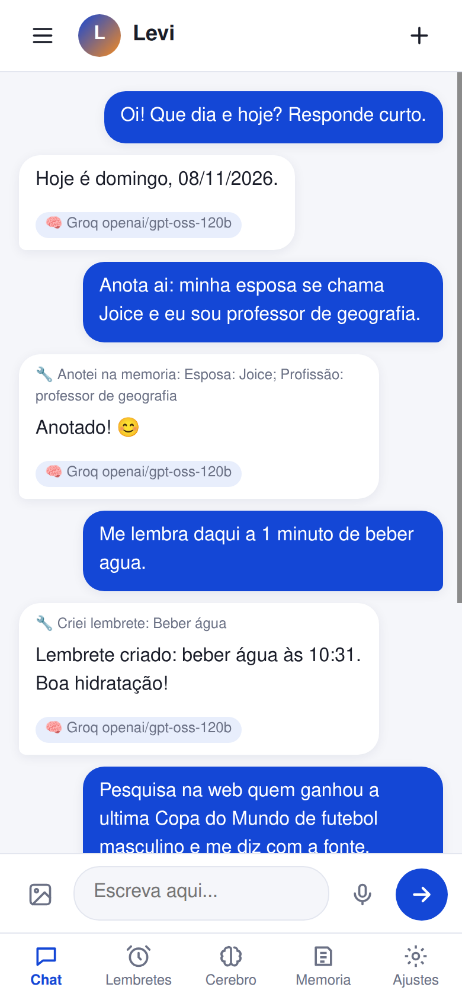
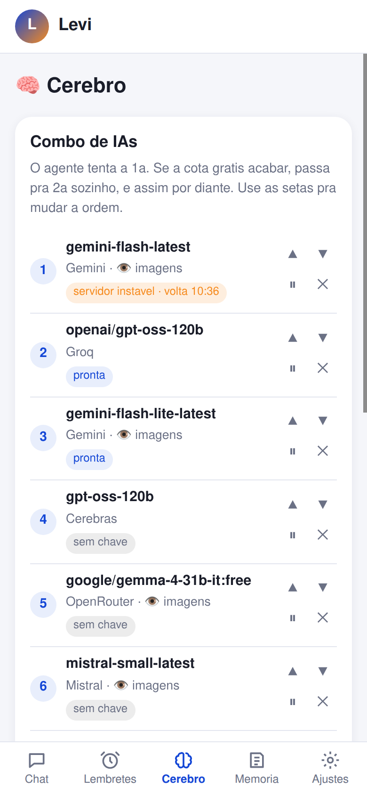
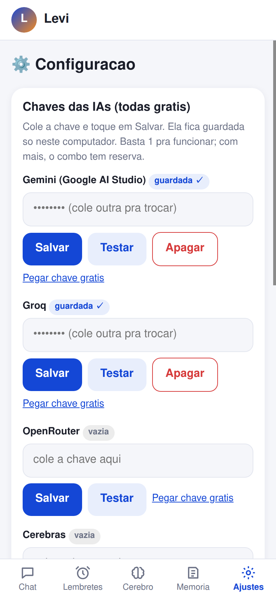
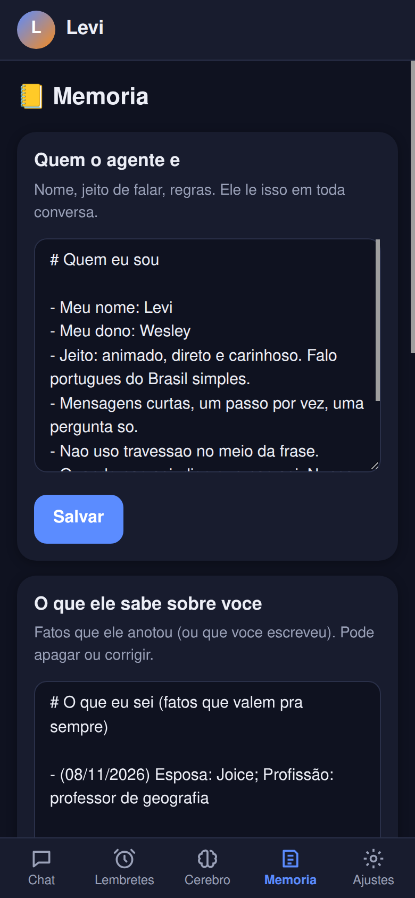

# 🤖 Agente Local

Um assistente pessoal **seu**, que roda num computador da sua casa (pode ser um notebook velho) e que voce usa pelo **celular, tablet ou PC**, de qualquer lugar.

- **100% gratis**: usa so IAs com plano gratuito (Gemini, Groq, OpenRouter, Cerebras, Mistral).
- **Varias IAs juntas (combo)**: se a cota gratis de uma acabar, ele passa sozinho pra proxima.
- **Tem memoria**: lembra do que voce contou, com um diario de cada dia.
- **Faz coisas**: cria lembretes, pesquisa na internet, le paginas, entende foto e audio.
- **Privado**: suas conversas e chaves ficam so no seu computador. Nada fica aberto na internet.

<p>




</p>

> A IA nao roda no seu computador (ele so conversa com elas pela internet). Por isso serve ate maquina antiga: o agente usa uns 80 MB de memoria.

---

## O que voce precisa

1. Um computador ligado na tomada e na internet, com **Ubuntu** (de preferencia Ubuntu Server 24.04).
2. Uma conta gratis no **Tailscale** (tailscale.com), pra abrir o agente fora de casa.
3. Pelo menos **uma chave gratis** de IA. A mais facil: Gemini, em https://aistudio.google.com/apikey

---

## Passo a passo

### 1. Instalar (uma vez so)

No computador que vai ficar ligado, digite este comando e aperte Enter:

```bash
git clone https://github.com/wesleymendes0703-bit/agente-local.git ~/agente-local && bash ~/agente-local/install.sh
```

O que vai acontecer:
- ele pede a **senha do computador** (e normal, e pra instalar);
- instala tudo sozinho (leva uns 5 minutos);
- aparece um **link do Tailscale**: abra no celular e entre com a sua conta;
- no fim aparece, grande, o **endereco pra abrir no celular**.

### 2. Abrir no celular

1. Instale o app **Tailscale** no celular e entre com a mesma conta.
2. Abra o endereco que apareceu no fim da instalacao (algo como `https://levisia.xxxx.ts.net`).
3. No menu do navegador, toque em **"Adicionar a tela inicial"**. Pronto: virou um app com icone.

### 3. Primeiro acesso

Na primeira vez, o app pede:
- o **nome do seu agente** (ex.: Levi);
- o **seu nome**;
- uma **senha** pra entrar (guarde ela).

### 4. Colar as chaves

Va em **Ajustes** (a engrenagem embaixo):
1. Toque em **"Pegar chave gratis"** do lado do Gemini e copie a chave.
2. Cole no campo e toque em **Salvar**.
3. Toque em **Testar**. Apareceu "funcionando"? Tudo certo.

Quanto mais chaves, mais reserva o combo tem. A da **Groq** tambem libera o **audio** (o microfone do chat).

### 5. Usar

Fale com ele como num WhatsApp. Exemplos:
- "Me lembra amanha as 9h de pagar a conta de luz"
- "Todo dia as 7h me manda a previsao do tempo de Votorantim" (ele mesmo pesquisa na hora)
- "Anota que a Joice faz aniversario em 12 de maio"
- "Pesquisa o que e o fenomeno El Nino e me explica facil"
- mande uma foto e pergunte o que tem nela.

---

## As telas

| Tela | Pra que serve |
|---|---|
| 💬 **Chat** | Conversar. Embaixo de cada resposta aparece qual IA respondeu (toque pra ver as que ele tentou antes). O ☰ abre as conversas antigas. |
| ⏰ **Lembretes** | Ver, criar e apagar lembretes. Ligue os **avisos** pro celular apitar na hora. |
| 🧠 **Cerebro** | O combo de IAs: mude a ordem com as setas, pause ou tire uma IA, adicione modelos novos. |
| 📒 **Memoria** | Quem o agente e (nome, jeito de falar) e o que ele sabe sobre voce. Pode editar tudo. Tem o diario de cada dia. |
| ⚙️ **Ajustes** | Chaves das IAs, tema claro/escuro, trocar senha, sair. |

---

## Duvidas comuns

**O microfone ou os avisos nao funcionam.**
Eles so funcionam no endereco **https** do Tailscale. Se o instalador avisou que o HTTPS esta desligado: entre em login.tailscale.com, va em **DNS**, ligue **MagicDNS** e **HTTPS Certificates**, e rode o instalador de novo (`bash ~/agente-local/install.sh`).

**Apareceu "Nenhuma IA respondeu agora".**
A cota gratis de todas acabou ou as chaves estao erradas. Va em **Cerebro** e veja o motivo de cada uma. Esperar uns minutos resolve; colocar mais uma chave tambem.

**Esqueci a senha.**
No computador do agente, rode: `rm ~/agente-local/dados/agente.db` e abra o app de novo. Isso apaga as conversas e a senha, mas **nao** apaga a memoria (pasta `dados/`) nem as chaves.

**Atualizar pra versao nova:** `bash ~/agente-local/atualizar.sh`

**Desinstalar:** `bash ~/agente-local/desinstalar.sh` (ele pergunta antes de apagar seus dados).

**O agente pode mexer no meu computador?**
Nao. Ele nao tem acesso ao terminal. So consegue: anotar na memoria, criar lembretes, pesquisar na internet, ler paginas publicas e ver a hora.

---

## De onde vem cada IA gratis

| IA | Onde pegar a chave | Observacao |
|---|---|---|
| Gemini | https://aistudio.google.com/apikey | A melhor pra comecar; entende fotos. |
| Groq | https://console.groq.com/keys | Muito rapida; tambem transcreve audio. |
| OpenRouter | https://openrouter.ai/keys | So usamos os modelos terminados em `:free`. |
| Cerebras | https://cloud.cerebras.ai | Rapida, boa reserva. |
| Mistral | https://console.mistral.ai/api-keys | Plano gratis "Experiment" (pede numero de celular; eles podem usar as conversas pra treinar). |

Detalhes tecnicos para quem programa: [LEIA-DEV.md](LEIA-DEV.md).
